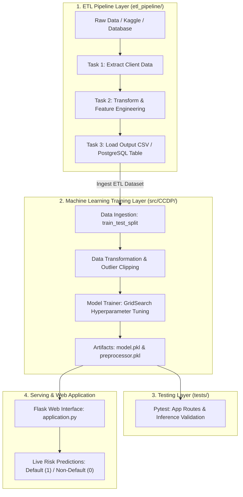

<<<<<<< HEAD
# 💳 Credit Card Default Prediction System (CCDP)


An end-to-end enterprise Machine Learning solution designed to predict the probability of a client defaulting on their credit card payment based on customer demographics, bill statement history, and repayment behavior. This project equips financial institutions with risk analytics to assess credit exposure and reduce non-performing loans.

---

## 📊 End-to-End System Architecture



---

## ✨ Key Features

- **Automated ETL Pipeline**: Orchestrated using **Apache Airflow DAGs** (TaskFlow API) and a **Standalone Python Runner** with automatic schema standardization, categorical mapping, and data cleaning.
- **Financial Feature Engineering**: Calculates credit utilization, debt-to-bill ratios, repayment delay metrics, bill trajectory trends, and age demographics.
- **Modular Machine Learning Pipeline**: Scikit-Learn pipeline handling imputation, robust outlier clipping, and scaling.
- **Multi-Model Comparison**: Evaluates Logistic Regression, Random Forest, and Gradient Boosting with automated hyperparameter tuning via GridSearchCV.
- **Experiment Tracking**: Integrated with MLflow and DagsHub for experiment tracking and model registration.
- **Interactive Web Application**: Flask web portal enabling interactive risk assessment on customer profiles.
- **Comprehensive Testing Suite**: Unit and integration tests covering data pipelines, preprocessors, inference logic, and Flask web endpoints.

---

## 📈 Financial Risk Features Engineered

| Feature Name | Description | Calculation Logic |
| :--- | :--- | :--- |
| `AVG_PAY_DELAY` | Mean repayment delay across past 6 months | `mean(PAY_0, PAY_2, ..., PAY_6)` |
| `MAX_PAY_DELAY` | Peak delinquency status reached | `max(PAY_0, PAY_2, ..., PAY_6)` |
| `NUM_MONTHS_DELAYED` | Total count of delinquent months | `sum(PAY_i > 0)` |
| `TOTAL_BILL_AMT` | Cumulative bill statement liability | `sum(BILL_AMT1 ... BILL_AMT6)` |
| `CREDIT_UTILIZATION` | Latest credit line utilization ratio | `BILL_AMT1 / (LIMIT_BAL + 1e-5)` |
| `BILL_TREND` | Net debt trajectory (Recent vs. Historical) | `BILL_AMT1 - BILL_AMT6` |
| `PAY_TO_BILL_RATIO` | Cumulative payment to bill ratio | `TOTAL_PAY_AMT / (TOTAL_BILL_AMT + 1e-5)` |
| `AGE_GROUP` | Demographic age category | Binned: `[20-30, 30-40, 40-50, 50-60, 60+]` |

---

## 🏆 Model Performance & Evaluation Results

The models were trained and tuned using **3-fold Cross-Validation** with **GridSearchCV**, evaluated on test set **ROC-AUC** (Receiver Operating Characteristic - Area Under Curve):

| Model | Hyperparameter Search Space | Test ROC-AUC | Status |
| :--- | :--- | :--- | :--- |
| **Random Forest** | `n_estimators: [100, 200]`, `max_depth: [10, 20, None]`, `min_samples_leaf: [1, 20]` | **78.24%** (0.7824) | 🥇 **Best Model (Selected & Deployed)** |
| **Gradient Boosting** | `n_estimators: [100, 200]`, `learning_rate: [0.05, 0.1]`, `max_depth: [4, 6]` | **78.20%** (0.7820) | 🥈 Runner-Up |
| **Logistic Regression** | `C: [0.1, 1.0, 10.0]`, `class_weight: 'balanced'`, `max_iter: 1000` | **76.20%** (0.7620) | 🥉 Baseline |

*The top-performing **Random Forest** classifier is automatically serialized to `artifacts/model.pkl` along with the feature transformation preprocessor `artifacts/preprocessor.pkl` for live inference in the Flask web app.*

---

## 🚀 Getting Started & Execution Flow

### Prerequisites
- Python 3.8+ (recommended Python 3.10+)
- Git

### 1. Installation
```bash
# Clone the repository
git clone https://github.com/harshal3558/CreditCardDefaultPrediction.git
cd CreditCardDefaultPrediction

# Create and activate virtual environment
python -m venv venv
source venv/bin/activate       # On Linux/macOS
# .\venv\Scripts\activate      # On Windows (PowerShell)

# Install dependencies
pip install -r requirements.txt
```

---

### 2. Running the Complete Pipeline

#### **Step 1: Execute the ETL Pipeline**
Extracts raw credit data, runs feature engineering, and writes the curated dataset:
```bash
python etl_pipeline/main.py
```
*Output:* Saves `etl_pipeline/include/transformed_credit_card_default.csv`.

*(Optional)* Run orchestrated via Apache Airflow:
```bash
cd etl_pipeline
docker compose up -d
```
Access the Airflow UI at `http://localhost:8080` (Username: `airflow`, Password: `airflow`).

---

#### **Step 2: Train the Machine Learning Model**
Ingests the ETL dataset, applies transformations, tunes models, and exports artifacts:
```bash
python main.py
```
*(Or invoke directly: `python -m src.CCDP.pipelines.training_pipeline`)*

*Outputs:*
* `artifacts/train.csv` and `artifacts/test.csv`
* `artifacts/preprocessor.pkl`
* `artifacts/model.pkl`

---

#### **Step 3: Run the Test Suite**
Validate inference logic, preprocessor transforms, and web endpoints:
```bash
# Run pytest web route suite
pytest tests/test_app.py

# Run end-to-end model inference and API test
python tests/test_inference_and_app.py
```

---

#### **Step 4: Launch the Web Application**
Start the prediction service locally:
```bash
python application.py
```
Visit:
* **Landing Page:** [http://127.0.0.1:5000/](http://127.0.0.1:5000/)
* **Risk Prediction Portal:** [http://127.0.0.1:5000/predictdata](http://127.0.0.1:5000/predictdata)

---

## 📂 Project Structure

```text
CreditCardDefaultPrediction/
├── application.py                      # Flask web application entrypoint
├── main.py                             # End-to-end training pipeline runner
├── requirements.txt                    # Project Python dependencies
├── setup.py                            # Package setup configuration
├── artifacts/                          # Serialized models and processed data
│   ├── model.pkl                       # Trained classification model
│   ├── preprocessor.pkl                # Fitted feature preprocessing pipeline
│   ├── train.csv                       # Training dataset split
│   └── test.csv                        # Testing dataset split
├── etl_pipeline/                       # Dedicated ETL Pipeline Subsystem
│   ├── main.py                         # Standalone ETL pipeline runner
│   ├── Dockerfile                      # Airflow custom container image
│   ├── docker-compose.yml              # Airflow + PostgreSQL services
│   ├── dags/
│   │   └── etl_credit_card_default.py  # Airflow DAG (TaskFlow API)
│   ├── include/                        # Curated ETL output dataset
│   └── tests/                          # Airflow DAG integrity tests
├── src/                                # Core Machine Learning Source Package
│   └── CCDP/
│       ├── components/
│       │   ├── data_ingestion.py       # Ingests ETL dataset & splits data
│       │   ├── data_transformation.py  # Scikit-learn feature pipeline & scaling
│       │   └── model_trainer.py        # Model tuning, evaluation & MLflow logging
│       ├── pipelines/
│       │   ├── prediction_pipeline.py  # Inference pipeline for new data
│       │   └── training_pipeline.py    # Modular training runner
│       ├── exception.py                # Custom exception handling with traceback
│       ├── logger.py                   # Timestamped logging configuration
│       └── utils.py                    # Object serialization & model evaluation
├── templates/                          # HTML user interface templates
│   ├── index.html                      # Welcome / landing page
│   └── home.html                       # Credit risk input form & results display
└── tests/                              # Application & model integration tests
    ├── test_app.py                     # Flask endpoint tests
    └── test_inference_and_app.py       # End-to-end inference & prediction tests
```

---

## 🤝 Contributing

1. Fork the Project
2. Create your Feature Branch (`git checkout -b feature/AmazingFeature`)
3. Commit your Changes (`git commit -m 'Add some AmazingFeature'`)
4. Push to the Branch (`git push origin feature/AmazingFeature`)
5. Open a Pull Request

---

## 📩 Contact & Support

**Harshal** - [harshal3558@gmail.com](mailto:harshal3558@gmail.com)  
Project Repository: [CreditCardDefaultPrediction](https://github.com/harshal3558/CreditCardDefaultPrediction)

=======
## End to End Credit Card Default Prediction

# Steps for Implementation

* Data Exploration & Cleaning

Load raw.csv and explore the dataset.
Handle missing values, duplicates, and outliers.
Perform data visualization to understand patterns.

* Feature Engineering

    1. Encode categorical variables.
    2. Normalize/scale numerical variables if required.
    3. Feature selection and transformation.

* Model Building

    1. Split data into training and testing sets.
    2. Try different machine learning models (e.g., Logistic Regression, Random Forest, XGBoost).
    3. Optimize hyperparameters for the best performance.

* Model Evaluation

    1. Use metrics like Accuracy, Precision, Recall, and AUC-ROC.
    2. Compare model performances.

* Deployment & API

    1. Convert the trained model into an API or web interface.
    2. Deploy on a cloud service like AWS/GCP/Azure.

* Documentation & Submission

    1. Create a README, HLD, LLD, and system architecture.
    2.  Submit code on GitHub with proper documentation.


# Logistic Regression Performance

* Accuracy: 80.8%
* Precision: 68.7%
* Recall: 24.3%
* AUC-ROC: 60.6%

Observations

* The model has good accuracy but low recall, meaning it struggles to identify defaults.
* Precision is decent, meaning when it predicts a default, it's likely correct.
* AUC-ROC of 60.6% suggests we can improve the model.


# Random Forest Performance

* Accuracy: 81.4%
* Precision: 64.1%
* Recall: 35.9% (better than Logistic Regression)
* AUC-ROC: 65.1% (better than Logistic Regression)

Observations

* Improved recall compared to Logistic Regression (24.3% → 35.9%).
* AUC-ROC increased, indicating better overall performance.
* Still room for improvement, possibly with XGBoost.


# XGBoost Performance

* Accuracy: 81.5%
* Precision: 65.5%
* Recall: 37.1% (highest so far)
* AUC-ROC: 65.8% (best so far)

Observations

* XGBoost outperforms both Logistic Regression and Random Forest in recall and AUC-ROC.
* Higher recall means it catches more defaults, which is crucial in financial risk assessment.
* Best overall performance, making it the preferred model for this task.


Next Steps
Save the trained model.
Deploy via API or web interface.
Document the workflow for submission.


# Deep Learning Implementation Plan

1. Data Preprocessing
Drop ID column (not useful).
Fix categorical variables (EDUCATION, MARRIAGE).
Normalize numerical features using StandardScaler.
Split data into train (80%) and test (20%) sets.

2. Build Neural Network Model
Input layer: 23 features.
2-3 hidden layers with ReLU activation.
Dropout layers for regularization.
Output layer: Sigmoid activation (binary classification).

3. Training & Evaluation
Loss function: Binary Crossentropy.
Optimizer: Adam.
Metrics: Accuracy, Precision, Recall, AUC-ROC.
Train for 50-100 epochs.

4. Compare Results with XGBoost
Check accuracy, precision, recall, and AUC-ROC.
Determine which model performs better.


<!-- # Credit Card Default Prediction

Credit Card Default Prediction is an intermediate-level machine learning project targeting the banking domain, where the goal is to predict the probability of a client defaulting on their credit card payment based on customer characteristics and payment history.

### Project Overview

- **Domain**: Banking, Financial Risk
- **Objective**: Predict the probability of credit card default using machine learning, enabling commercial banks to assess and manage credit risk more effectively.
- **Technologies**: Python, Machine Learning, Cassandra database, Cloud hosting (AWS, Azure, or GCP), API/UI (optional).

***

### Problem Statement

Financial threats from credit risk are increasing with the rapid expansion of the financial sector. This project addresses the critical challenge commercial banks face: accurately predicting the risk of customer default on credit card payments using automated data-driven models.

***

### Dataset

- **Source**: Project dataset provided (Cassandra database format)
- **Sample Link**: Refer to project documentation or ask course mentor for dataset access
- **Features**: Includes customer demographics, credit card usage history, and payment records.

***

### Approach & Workflow

1. **Data Exploration & Cleaning**
   - Conduct exploratory data analysis (EDA) to understand dataset characteristics.
   - Clean data by handling missing values and outliers.

2. **Feature Engineering**
   - Create meaningful input features from raw data to improve predictive model performance.

3. **Model Building**
   - Implement and train multiple machine learning algorithms (e.g., Logistic Regression, Random Forest, XGBoost).
   - Perform model selection based on project-specified evaluation metrics.

4. **Model Evaluation**
   - Evaluate performance using metrics such as accuracy, precision, recall, F1-score, and AUC.
   - Document results and optimize for best-performing model.

5. **Deployment**
   - Expose the solution as a REST API or integrate a basic user interface for prediction serving.
   - Ensure code portability and maintainability.

6. **Logging & Monitoring**
   - Use Python’s `logging` module to log all significant actions and predictions for traceability.

7. **CI/CD & Ops Pipeline**
   - (Optional) Implement MLOps pipelines—e.g., MLflow, DVC, or cloud services—to streamline model delivery and monitoring.

***

### Project Structure

- `data/` — Raw and processed datasets.
- `notebooks/` — Jupyter/Colab notebooks for data analysis, feature engineering, and model experiments.
- `src/` — Core source code modules (data loader, model, utils, etc.).
- `api/` — (Optional) Code for the deployed API or frontend.
- `tests/` — Unit and integration test scripts.
- `logs/` — Application logs.
- `README.md` — This file.

***

### How to Run

1. **Install dependencies**:  
   ```bash
   pip install -r requirements.txt
   ```

2. **Run EDA/Model scripts**:  
   Execute the analysis and model training scripts as described in `notebooks/` or `src/`.

3. **Run as API/UI (optional)**:  
   To launch the API or user interface, run the deployment script or start the web server as documented in `api/README.md`.

4. **Testing**:  
   All modules are testable; run test suite via:
   ```bash
   pytest tests/
   ```

***

### Evaluation Metrics

- Accuracy
- Precision
- Recall
- F1 Score
- AUC

***

### Coding & Documentation Standards

- Write modular, maintainable, and testable code (follow [PEP-8](https://www.python.org/dev/peps/pep-0008/)).
- Keep the GitHub repository public for review.
- Include detailed project documentation:  
  - High-level and low-level design documents  
  - Solution architecture and wireframes  
  - Model response latency and optimization details  
  - Test case documentation  
  - Demo video and LinkedIn post links (if required for course submission).

***

### Deployment & Design Notes

- The solution must justify the deployment choice (cloud/edge/local).
- Submit complete solution design (HLD, LLD, architecture, wireframe) and a detailed project report as requested.
- Measure and report model response times and all optimizations performed.

***

### References

- Dataset: (Refer to dataset source in project documentation)
- Design and project templates: (Sample HLD, LLD, Architecture, and Wireframe links provided in project documentation).

***

This README provides a high-level guide to implementing and delivering a robust, portable credit card default prediction system as required by the project brief.
>>>>>>> 05ee793033cf1ee3f90388c639613c1eced0eb36
