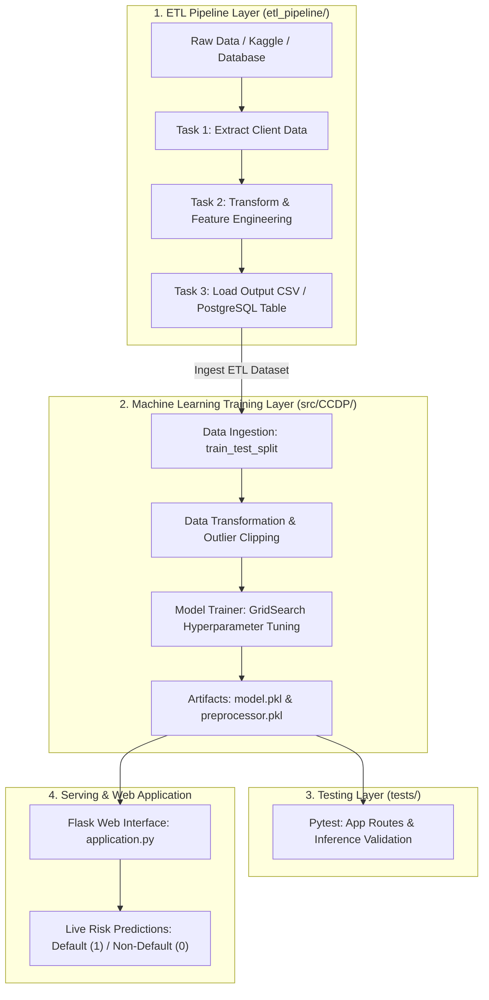

# Credit Card Default Prediction System (CCDP)


An end-to-end enterprise Machine Learning solution designed to predict the probability of a client defaulting on their credit card payment based on customer demographics, bill statement history, and repayment behavior. This project equips financial institutions with risk analytics to assess credit exposure and reduce non-performing loans.

---

## 📊 End-to-End System Architecture



---

## ✨ Key Features

- **Automated ETL Pipeline**: Orchestrated using **Apache Airflow DAGs** (TaskFlow API) and a **Standalone Python Runner** with automatic schema standardization, categorical mapping, and data cleaning.
- **Financial Feature Engineering**: Calculates credit utilization, debt-to-bill ratios, repayment delay metrics, bill trajectory trends, and age demographics.
- **Modular Machine Learning Pipeline**: Scikit-Learn pipeline handling imputation, robust outlier clipping, and scaling.
- **Multi-Model Comparison**: Evaluates Logistic Regression, Random Forest, and Gradient Boosting with automated hyperparameter tuning via GridSearchCV.
- **Experiment Tracking**: Integrated with MLflow and DagsHub for experiment tracking and model registration.
- **Interactive Web Application**: Flask web portal enabling interactive risk assessment on customer profiles.
- **Comprehensive Testing Suite**: Unit and integration tests covering data pipelines, preprocessors, inference logic, and Flask web endpoints.

---

## 📈 Financial Risk Features Engineered

| Feature Name | Description | Calculation Logic |
| :--- | :--- | :--- |
| `AVG_PAY_DELAY` | Mean repayment delay across past 6 months | `mean(PAY_0, PAY_2, ..., PAY_6)` |
| `MAX_PAY_DELAY` | Peak delinquency status reached | `max(PAY_0, PAY_2, ..., PAY_6)` |
| `NUM_MONTHS_DELAYED` | Total count of delinquent months | `sum(PAY_i > 0)` |
| `TOTAL_BILL_AMT` | Cumulative bill statement liability | `sum(BILL_AMT1 ... BILL_AMT6)` |
| `CREDIT_UTILIZATION` | Latest credit line utilization ratio | `BILL_AMT1 / (LIMIT_BAL + 1e-5)` |
| `BILL_TREND` | Net debt trajectory (Recent vs. Historical) | `BILL_AMT1 - BILL_AMT6` |
| `PAY_TO_BILL_RATIO` | Cumulative payment to bill ratio | `TOTAL_PAY_AMT / (TOTAL_BILL_AMT + 1e-5)` |
| `AGE_GROUP` | Demographic age category | Binned: `[20-30, 30-40, 40-50, 50-60, 60+]` |

---

## 🏆 Model Performance & Evaluation Results

The models were trained and tuned using **3-fold Cross-Validation** with **GridSearchCV**, evaluated on test set **ROC-AUC** (Receiver Operating Characteristic - Area Under Curve):

| Model | Hyperparameter Search Space | Test ROC-AUC | Status |
| :--- | :--- | :--- | :--- |
| **Gradient Boosting** | `n_estimators: [100, 200]`, `learning_rate: [0.05, 0.1]`, `max_depth: [4, 6]` | **78.41%** (0.7841) | 🥇 **Best Model (Selected & Deployed)** |
| **Random Forest** | `n_estimators: [100, 200]`, `max_depth: [10, 20, None]`, `min_samples_leaf: [1, 20]` | **78.24%** (0.7824) | 🥈 Runner-Up |
| **Logistic Regression** | `C: [0.1, 1.0, 10.0]`, `class_weight: 'balanced'`, `max_iter: 1000` | **76.20%** (0.7620) | 🥉 Baseline |

*The top-performing **Gradient Boosting** classifier is automatically serialized to `artifacts/model.pkl` along with the feature transformation preprocessor `artifacts/preprocessor.pkl` for live inference in the Flask web app.*

---

## 🚀 Getting Started & Execution Flow

### Prerequisites
- Python 3.8+ (recommended Python 3.10+)
- Git

### 1. Installation
```bash
# Clone the repository
git clone https://github.com/harshal3558/CreditCardDefaultPrediction.git
cd CreditCardDefaultPrediction

# Create and activate virtual environment
python -m venv venv
source venv/bin/activate       # On Linux/macOS
# .\venv\Scripts\activate      # On Windows (PowerShell)

# Install dependencies
pip install -r requirements.txt
```

---

### 2. Running the Complete Pipeline

#### **Step 1: Execute the ETL Pipeline**
Extracts raw credit data, runs feature engineering, and writes the curated dataset:
```bash
python etl_pipeline/main.py
```
*Output:* Saves `etl_pipeline/include/transformed_credit_card_default.csv`.

*(Optional)* Run orchestrated via Apache Airflow:
```bash
cd etl_pipeline
docker compose up -d
```
Access the Airflow UI at `http://localhost:8080` (Username: `airflow`, Password: `airflow`).

---

#### **Step 2: Train the Machine Learning Model**
Ingests the ETL dataset, applies transformations, tunes models, and exports artifacts:
```bash
python main.py
```
*(Or invoke directly: `python -m src.CCDP.pipelines.training_pipeline`)*

*Outputs:*
* `artifacts/train.csv` and `artifacts/test.csv`
* `artifacts/preprocessor.pkl`
* `artifacts/model.pkl`

---

#### **Step 3: Run the Test Suite**
Validate inference logic, preprocessor transforms, and web endpoints:
```bash
# Run pytest web route suite
pytest tests/test_app.py

# Run end-to-end model inference and API test
python tests/test_inference_and_app.py
```

---

#### **Step 4: Launch the Web Application**
Start the prediction service locally:
```bash
python application.py
```
Visit:
* **Landing Page:** [http://127.0.0.1:5000/](http://127.0.0.1:5000/)
* **Risk Prediction Portal:** [http://127.0.0.1:5000/predictdata](http://127.0.0.1:5000/predictdata)

---

## 📂 Project Structure

```text
CreditCardDefaultPrediction/
├── application.py                      # Flask web application entrypoint
├── main.py                             # End-to-end training pipeline runner
├── requirements.txt                    # Project Python dependencies
├── setup.py                            # Package setup configuration
├── artifacts/                          # Serialized models and processed data
│   ├── model.pkl                       # Trained classification model
│   ├── preprocessor.pkl                # Fitted feature preprocessing pipeline
│   ├── train.csv                       # Training dataset split
│   └── test.csv                        # Testing dataset split
├── etl_pipeline/                       # Dedicated ETL Pipeline Subsystem
│   ├── main.py                         # Standalone ETL pipeline runner
│   ├── Dockerfile                      # Airflow custom container image
│   ├── docker-compose.yml              # Airflow + PostgreSQL services
│   ├── dags/
│   │   └── etl_credit_card_default.py  # Airflow DAG (TaskFlow API)
│   ├── include/                        # Curated ETL output dataset
│   └── tests/                          # Airflow DAG integrity tests
├── src/                                # Core Machine Learning Source Package
│   └── CCDP/
│       ├── components/
│       │   ├── data_ingestion.py       # Ingests ETL dataset & splits data
│       │   ├── data_transformation.py  # Scikit-learn feature pipeline & scaling
│       │   └── model_trainer.py        # Model tuning, evaluation & MLflow logging
│       ├── pipelines/
│       │   ├── prediction_pipeline.py  # Inference pipeline for new data
│       │   └── training_pipeline.py    # Modular training runner
│       ├── exception.py                # Custom exception handling with traceback
│       ├── logger.py                   # Timestamped logging configuration
│       └── utils.py                    # Object serialization & model evaluation
├── templates/                          # HTML user interface templates
│   ├── index.html                      # Welcome / landing page
│   └── home.html                       # Credit risk input form & results display
└── tests/                              # Application & model integration tests
    ├── test_app.py                     # Flask endpoint tests
    └── test_inference_and_app.py       # End-to-end inference & prediction tests
```

---

## 🤝 Contributing

1. Fork the Project
2. Create your Feature Branch (`git checkout -b feature/AmazingFeature`)
3. Commit your Changes (`git commit -m 'Add some AmazingFeature'`)
4. Push to the Branch (`git push origin feature/AmazingFeature`)
5. Open a Pull Request

---

## 📩 Contact & Support

**Harshal** - [harshal3558@gmail.com](mailto:harshal3558@gmail.com)  
Project Repository: [CreditCardDefaultPrediction](https://github.com/harshal3558/CreditCardDefaultPrediction)
